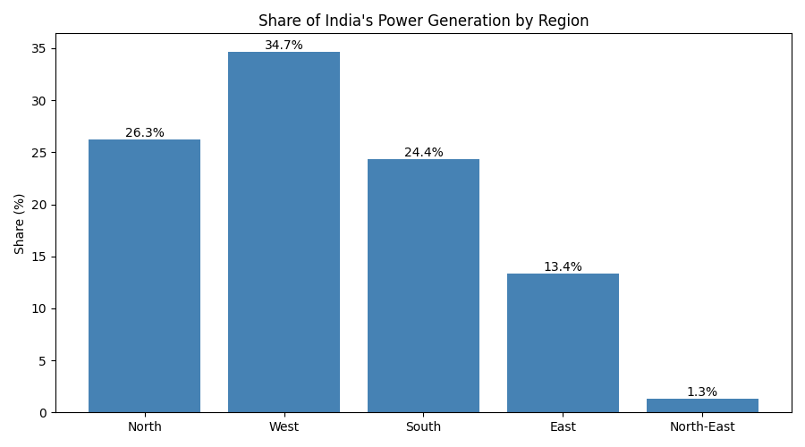
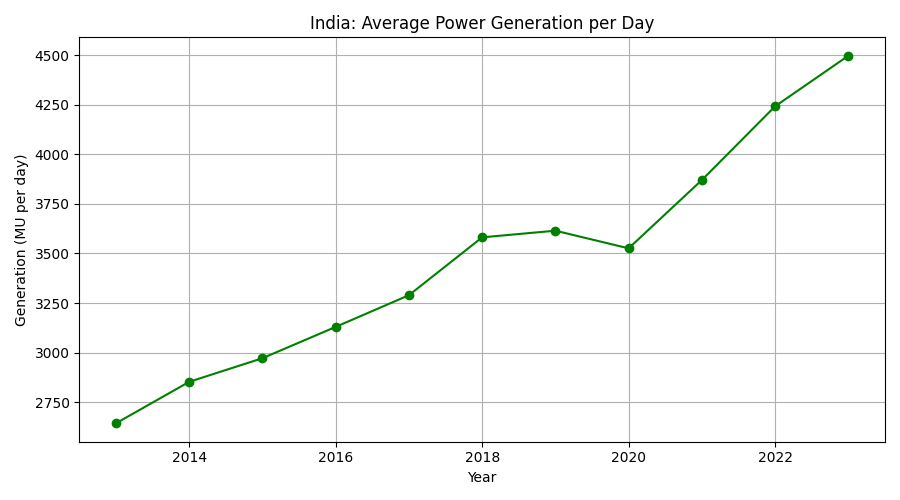
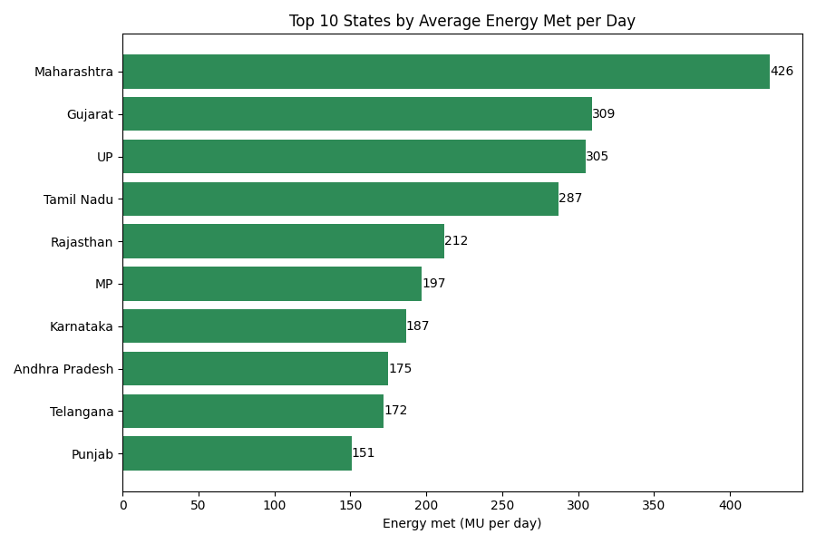
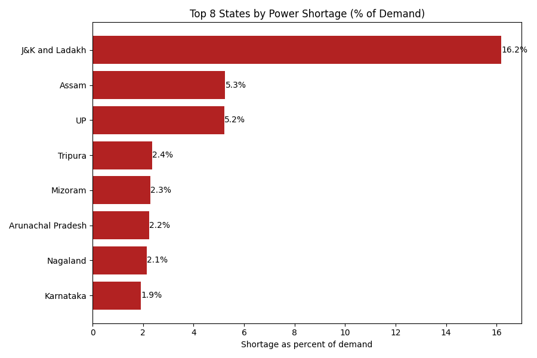
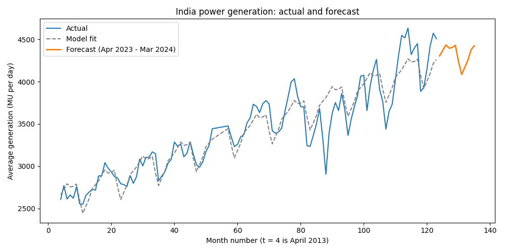

# India Power Generation Analysis

A data analysis project on daily electricity generation in India from 2013 to 2023. It looks at which regions and states generate and use the most power, how generation grew over the years, where shortages are highest, and a simple forecast for April 2023 to March 2024.

## Dataset

Kaggle dataset "Daily Power Generation in India [2013-2023]" by krishnadaskv. Generation is measured in MU (million units).

- `power_source.csv`: 18,251 rows of daily generation by region and source
- `power_states.csv`: 126,699 rows of daily state data, 126,679 after cleaning

## Tools Used

Python, pandas, matplotlib, scikit-learn

## What Was Done

1. Explored the data and cleaned it (`explore.py`, `clean.py`)
2. Compared regions and states (`analysis.py`, `analysis_states.py`)
3. Made charts for the main results (`charts.py`, `charts_states.py`, `charts_shortage.py`)
4. Built a linear regression model to forecast monthly generation (`forecast_prep.py`, `forecast_model.py`, `forecast_check.py`, `forecast_start.py`, `forecast_chart.py`)

## Results

**Share of generation by region:** Western 34.7%, Northern 26.3%, Southern 24.4%, Eastern 13.4%, North-Eastern 1.3%.



**Yearly growth:** Average generation per day grew from 2,644 MU in 2013 to 4,497 MU in 2023, about 70% growth. Most years grew 4 to 12%. 2019 (-3.1%) and 2020 (-3.0%) fell, and the 2020 fall fits COVID. Average per day was used because 2013 and 2023 are partial years (265 and 90 days).



**Months:** June is the highest month (3,546 MU per day) and November the lowest (3,179 MU per day), a gap of only about 10%.

**Top states by energy met (MU per day):** Maharashtra 426.4, Gujarat 309.4, Uttar Pradesh 304.8, Tamil Nadu 287.0, Rajasthan 212.2.



**Shortage:** By MW, Uttar Pradesh has the highest shortage (783.6). By percent of demand, Jammu & Kashmir and Ladakh are highest (16.18%), then Assam (5.25%) and Uttar Pradesh (5.22%). Percent is the fairer comparison because states differ in size. Only the 36 places with at least 1,500 days of data were kept.



## Forecast (April 2023 to March 2024)

A linear regression model using the month number (`t`) and month dummies. It was trained on 2013 to 2021 and tested on 2022 and 2023.



### Model limits

- It is a simple linear regression model.
- Test error is 308.5 MU per day (7.2%).
- It predicted too low in 13 of 15 test months, because 2022 and 2023 grew faster than ever before.
- Dropping older training years made the error worse (2015: 7.8%, 2017: 9.8%, 2019: 8.4%), so all years from 2013 were kept.
- The forecast is probably too low by a few hundred MU per day.

## Folder Structure

```
india-power-analysis/
├── charts/    (5 chart images)
├── data/      (raw and cleaned CSV files)
├── scripts/   (12 Python scripts)
├── .gitignore
└── README.md
```

## How to Run

Run every script from the main `india-power-analysis` folder, for example:

```
python scripts\clean.py
```